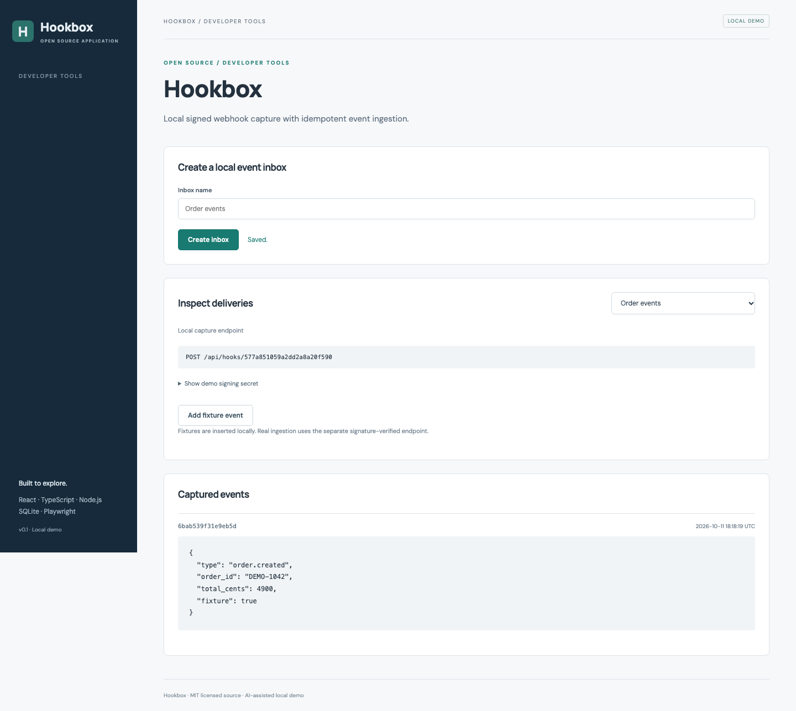

# Hookbox

Webhook inspection. An independently runnable open source application.



## Run and demonstrate

From this repository, run `npm ci` and `npm run dev`. Open http://127.0.0.1:5173/#webhooks.

Create an inbox and add an explicitly labeled fixture. Expand the event JSON. For the signed ingestion path, use the signing script below, then repeat it to observe duplicate detection.

## Implementation and decisions

HMAC SHA-256 is checked against exact request bytes using timing-safe comparison. Inbox/event IDs enforce idempotency. Fixture insertion is separate from signed ingestion and does not make an outbound HTTP request.

API implementation: [`server/projects/webhooks.ts`](server/projects/webhooks.ts). The React workflow is in [`src/main.tsx`](src/main.tsx); storage initialization and shared middleware are in [`server/app.ts`](server/app.ts).

## API

- `GET /api/inboxes` / `POST /api/inboxes` — list or create `{name}`; creation generates an ID and demo secret.
- `POST /api/hooks/:id` — ingest JSON using X-Webhook-Signature and X-Event-ID headers; first delivery returns HTTP 201, duplicate returns HTTP 200.
- `GET /api/inboxes/:id/events` — latest 100 captured deliveries.
- `POST /api/inboxes/:id/sample` — insert a labeled local fixture without signature verification.

## Verification

Run `npm test` for domain/API checks. Run `npm run build`, then `npm run test:e2e` for browser flows, including **Hookbox captures and inspects an explicitly labeled fixture**.

## Application description

> Hookbox: a local webhook inspection tool with raw-body HMAC verification, timing-safe comparison, per-inbox event idempotency, JSON inspection, and tests for tampering and repeated deliveries.

Use this as a description of the current project. Add your own reviewed contribution and disclose AI assistance when discussing development. Do not attach invented employment dates, client claims, production usage, or years of experience.

## Next contribution

Add secret rotation and a fixture that tests acceptance during a defined rotation window.

MIT licensed. Initial implementation created with AI assistance in October 2026; see [CONTRIBUTIONS.md](CONTRIBUTIONS.md).

## Exercise signed ingestion

Create an inbox in the UI, copy the ID from its capture endpoint, and reveal the **local demo** secret. From this repository:

```sh
node scripts/send-webhook.mjs INBOX_ID DEMO_SECRET
```

The first call returns HTTP 201 with `duplicate: false`; repeating the same script returns HTTP 200 with `duplicate: true`. The script targets only loopback. Management endpoints are unauthenticated, so use fictional data and keep this demo local.

## Scope

This is a single-user local demonstration with fictional data. It has no account authentication or multi-tenant authorization. Keep it bound to loopback. Initial code was developed with AI assistance in October 2026 and extracted from Portfolio Workbench.
